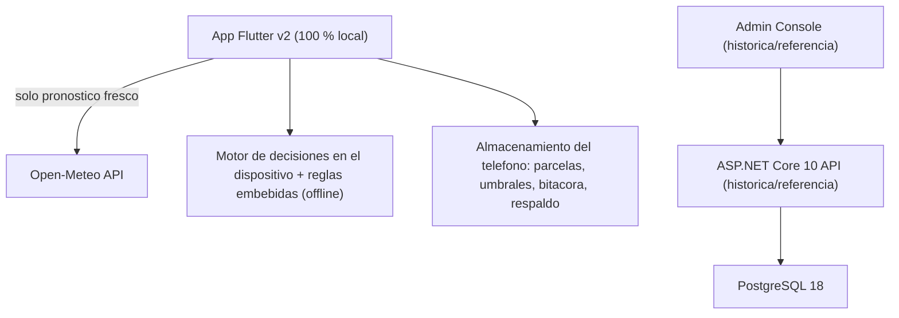

<div align="center">
  
  <br><br>

  
  
  
  
  
  
</div>

<!-- README-I18N:START -->

[English](./README.md) | **Español**

<!-- README-I18N:END -->

# CosechaClima

**Sistema de alerta agroclimática temprana para pequeños productores de granos básicos en Nicaragua.**

Cruza datos climáticos en tiempo real contra un árbol de decisión agronómico para traducir el clima en un plan de acciones concretas que un productor puede seguir esta semana — sin costo, sin conexión constante, sin depender de un técnico presente.

---

## Tabla de contenido

- [El problema](#el-problema)
- [Como funciona](#como-funciona)
- [Arquitectura](#arquitectura)
- [Stack tecnologico](#stack-tecnologico)
- [Estructura del repositorio](#estructura-del-repositorio)
- [Puesta en marcha](#puesta-en-marcha)
- [Seguridad](#seguridad)
- [Costo de infraestructura](#costo-de-infraestructura)
- [Como contribuir](#como-contribuir)
- [Agradecimientos](#agradecimientos)
- [Licencia](#licencia)

---

## El problema

En Nicaragua, los granos básicos como el maíz y el frijol son la base de la seguridad alimentaria y ocupan la mayor parte del área agrícola del país (dato oficial: Plan Nacional de Producción, Banco Central de Nicaragua). Los pequeños productores toman decisiones críticas de manejo — regar, drenar, proteger del viento — basándose en la observación directa del cielo, sin acceso a pronósticos localizados ni a un técnico agrónomo disponible todos los días.

CosechaClima traduce datos climáticos abiertos en una recomendación accionable de 3 pasos, adaptada al cultivo, la etapa fenológica y el tipo de suelo de cada parcela específica.

## Como funciona

1. El productor registra su parcela: cultivo, etapa fenológica, tipo de suelo y coordenadas GPS.
2. Configura sus propios umbrales de riesgo (mm de lluvia, km/h de viento, días de canícula).
3. El sistema consulta datos climáticos reales de la zona vía Open-Meteo.
4. El **motor de decisiones en el teléfono** evalúa todos los eventos climáticos activos simultáneamente contra **540 reglas agronómicas** embebidas en la app y selecciona la alerta con el nivel de riesgo más severo (Alto / Medio / Bajo / Sin riesgo) con 3 acciones recomendadas.
5. El productor registra en su bitácora local qué acciones completó y puede compartir un resumen de texto simple.

**La app móvil v2 es 100 % local.** No necesita cuenta, servidor, URL de API ni archivo de entorno. Las parcelas, los umbrales y la bitácora viven en el teléfono y se pueden exportar como respaldo JSON. La única dependencia externa es Open-Meteo para pronósticos frescos; el último pronóstico (hasta 3 días) y la última evaluación completa mantienen la app funcionando sin conexión.

## Arquitectura



**App móvil local-first:** el semáforo y el plan semanal se calculan **en el teléfono** con datos de Open-Meteo (con copia local) y 540 reglas agronómicas embebidas en la app. La app no tiene cuentas, llamadas al backend ni sincronización remota. El backend y el Admin Console quedan en el repositorio como código histórico/de referencia, pero la app móvil no los necesita. Ver [docs/local-first.md](docs/local-first.md).

## Stack tecnologico

| Capa | Tecnologia | Justificacion |
|---|---|---|
| Backend | ASP.NET Core 10 | LTS vigente, tipado fuerte, rendimiento |
| Base de datos | PostgreSQL 18 (Docker) | Gratuita, uso comercial permitido (SQL Server Developer no tiene licencia para producción) |
| Acceso a datos | Npgsql, SQL explícito (sin ORM) | Control total sobre consultas, upserts `ON CONFLICT`, migraciones versionadas. Ver [docs/postgresql.md](docs/postgresql.md) |
| Autenticacion (solo backend) | JWT Bearer de 15 min + refresh token rotado + correo/contraseña (PBKDF2 + salt) + Google Sign-In + Jti | Se conserva para el backend histórico; la app móvil v2 no tiene cuentas |
| Datos climaticos | [Open-Meteo](https://open-meteo.com) (consultado directo desde la app) | Pronostico real hasta 16 dias, sin API key. Gratuito solo para uso **no comercial**; atribución CC BY 4.0 visible en la app |
| Notificaciones | `flutter_local_notifications` (en el dispositivo) | Sin Firebase/FCM: costo de infraestructura cero |
| Contenedorizacion | Docker multi-stage (Alpine / nginx) | Imagen optimizada, usuario no-root |
| Cliente movil | Flutter (solo productores, sin animaciones) | Codigo unico multiplataforma |
| Admin Console | Vite + React, sin framework de UI ni libs de animacion | Bundle de ~50 KB gzip, servido como estaticos por nginx |
| CI/CD | GitHub Actions | Build y test automatizados |

## Estructura del repositorio

```
CosechaClima/
|-- backend/
|   |-- WebApi/                    # API: controladores, DTOs, Program.cs
|   |-- WebApi.Models/             # Entidades de dominio
|   |-- Services/
|   |   |-- WebApi.Interface/      # Contratos de servicio
|   |   |-- WebApi.Implementation/ # Logica de negocio + ADO.NET
|   |-- Scripts/                   # Esquema SQL, seed, reglas JSON
|   |-- Dockerfile                 # Build multi-stage (SDK -> Alpine)
|-- mobile/                        # App Flutter v2 (100 % local, sin backend)
|-- adminconsole/                   # Admin Console web (Vite + React + nginx)
|-- docs/                          # Documentacion tecnica
|-- compose.yaml                   # Docker Compose (raiz del proyecto)
|-- .env.example                   # Plantilla de variables de entorno (raiz)
|-- .github/workflows/             # Pipelines CI/CD
|-- README.md
```

## Puesta en marcha

### App móvil (recomendado, sin backend)

**Prerequisitos:** Flutter SDK.

```bash
git clone https://github.com/Abemilek/CosechaClima.git
cd CosechaClima/mobile
flutter pub get
flutter run
```

No hace falta `.env`, `API_URL`, base de datos ni servidor. Ver [mobile/README.es.md](mobile/README.es.md) para almacenamiento local, funcionamiento sin conexión y copia de seguridad.

### Backend y Admin Console (histórico/referencia, opcional)

El stack de servidor original sigue disponible como referencia. **No** lo usa la app móvil v2.

**Prerequisitos:** Docker + Docker Compose instalados.

```bash
cd CosechaClima
cp .env.example .env
# Editar .env con tus valores (ver comentarios en .env.example)
docker compose up --build -d
```

Esto levanta tres servicios: `db` (PostgreSQL 18), `api` (el backend, puerto 8080; aplica las migraciones SQL al arrancar) y `adminconsole` (el panel web, puerto 5174).

Verificacion:

```bash
curl http://localhost:8080/health
```

Esperado: `200 OK` con `Healthy`.

Abri el Admin Console en `http://localhost:5174` e inicia sesion con la cuenta admin sembrada. Si no configuraste `ADMIN_SEED_PASSWORD` (o era muy debil), revisa los logs de la API para ver la clave generada automaticamente:

```bash
docker compose logs api | grep -i "admin"
```

> [!WARNING]
> `DB_APP_PASSWORD` debe ser la misma contraseña que pongas dentro de `CONNECTION_STRING`. `DB_ADMIN_PASSWORD` es el superusuario `postgres` (la API no lo usa).

> [!WARNING]
> PostgreSQL solo aplica las contraseñas la primera vez que inicializa el volumen. Para cambiarlas después: `ALTER ROLE cosechaclima_app PASSWORD '...'`. En desarrollo: `docker compose down -v && docker compose up --build` (borra los datos).

> [!NOTE]
> Para probar el Admin Console por `http://localhost` sin TLS pon `AUTH_COOKIE_SECURE=false` en el `.env`. Detrás de un proxy inverso define `PROXY_KNOWN_PROXY` / `PROXY_KNOWN_NETWORK` para que el rate limiting por IP vea la IP real del cliente.

> [!NOTE]
> `ASPNETCORE_ENVIRONMENT` es `Production` por defecto (Swagger oculto). Para desarrollo local poner `ASPNETCORE_ENVIRONMENT=Development` en `.env` y abrir `http://localhost:8080/swagger`.

> [!NOTE]
> **Google Sign-In pertenece solo al backend histórico.** La app móvil v2 no usa cuentas ni Google Sign-In. Las notas antiguas de configuración siguen en [docs/google-sign-in-setup.md](docs/google-sign-in-setup.md) para el backend.

> [!NOTE]
> `compose.yaml` inicia automaticamente: PostgreSQL, la API (que aplica las migraciones) (Dockerfile multi-stage) y el Admin Console (compilado con Vite, servido por nginx). Ver [backend/README.es.md](backend/README.es.md), [mobile/README.es.md](mobile/README.es.md) y [adminconsole/](adminconsole/) para instrucciones detalladas de cada componente.

## Seguridad (backend histórico)

- Access tokens JWT de 15 minutos (claim `Jti`) renovados con refresh tokens de un solo uso y rotados (se guarda su SHA-256; reutilizarlos revoca toda la sesión). Admin Console: access token solo en memoria + cookie `HttpOnly` `SameSite=Strict`.
- Inicio de sesion con Google: el ID Token se valida siempre en el servidor (firma, audiencia, expiracion y correo verificado).
- Contrasenas almacenadas exclusivamente como hash PBKDF2-SHA256 + salt individual por usuario (minimo 8 caracteres). Las cuentas de Google no tienen contraseña local.
- Comparacion de hash en tiempo constante (`CryptographicOperations.FixedTimeEquals`).
- Modo invitado acotado: solo `/api/auth/*`, el paquete de reglas, los catalogos y `/health` son publicos; todo lo demas exige JWT.
- Control de acceso por propietario (ownership) en todos los recursos, derivado del token.
- Rol `Admin` separado para operaciones administrativas, otorgado solo via seed de base de datos.
- Rate Limiting en endpoints de autenticacion (register, login y Google) y en el motor de decisiones.
- Manejador global de errores con estandar RFC 7807 (`ProblemDetails`).
- CORS restringido por lista explicita de origenes permitidos.
- Secretos gestionados por variables de entorno (`.env`), nunca hardcodeados.
- Runtime Docker con imagen Alpine, usuario no-root. Entorno `Production` por defecto.

Detalle completo en [docs/security.md](docs/security.md).

## Costo de infraestructura

**$0 para la app móvil y uso no comercial.** La app corre completamente en el teléfono; no hace falta servidor. PostgreSQL, ASP.NET Core, las notificaciones locales y el stack histórico opcional son gratuitos. Salvedad: la API gratuita de Open-Meteo es **solo para uso no comercial** (para uso comercial hay que contratar su plan de pago).

## Como contribuir

Este repositorio usa ramas de feature protegidas contra `main` y [Conventional Commits](https://www.conventionalcommits.org/). Detalle en [CONTRIBUTING.md](CONTRIBUTING.md).

## Agradecimientos

- [Open-Meteo](https://open-meteo.com) por el acceso gratuito a datos meteorologicos de alta resolucion.
- INTA Nicaragua y FAO por las guias tecnicas publicas de manejo de maiz y frijol.
- [OWASP API Security Project](https://owasp.org/www-project-api-security/) como marco de referencia para el endurecimiento de seguridad.

## Licencia

Este proyecto se distribuye bajo licencia MIT -- ver [LICENSE](LICENSE).