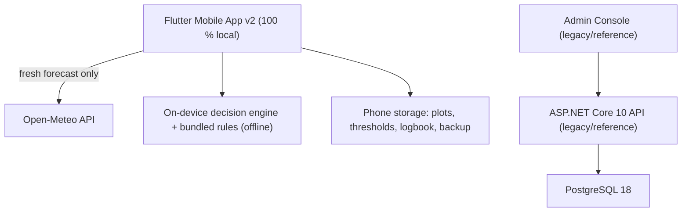

<div align="center">
  
  <br><br>

  
  
  
  
  
  
</div>

<!-- README-I18N:START -->

**English** | [Español](./README.es.md)

<!-- README-I18N:END -->

# CosechaClima

**Early-warning agroclimatic system for small-scale basic grain producers in Nicaragua.**

Cross-references real-time weather data against an agronomic decision tree to translate weather into a concrete plan of actions a producer can follow this week — at no cost, without constant connectivity, without depending on a technician being present.

---

## Table of Contents

- [The Problem](#the-problem)
- [How It Works](#how-it-works)
- [Architecture](#architecture)
- [Tech Stack](#tech-stack)
- [Repository Structure](#repository-structure)
- [Getting Started](#getting-started)
- [Security](#security)
- [Infrastructure Cost](#infrastructure-cost)
- [How to Contribute](#how-to-contribute)
- [Acknowledgments](#acknowledgments)
- [License](#license)

---

## The Problem

In Nicaragua, basic grains like corn and beans are the foundation of food security and occupy most of the country's agricultural area (official data: Plan Nacional de Producción, Banco Central de Nicaragua). Small producers make critical management decisions — irrigate, drain, protect from wind — based on direct sky observation, without access to localized forecasts or an agronomic technician available every day.

CosechaClima translates open weather data into an actionable 3-step recommendation, adapted to the crop, phenological stage, and soil type of each specific plot.

## How It Works

1. The producer registers their plot: crop, phenological stage, soil type, and GPS coordinates.
2. Configures their own risk thresholds (mm of rain, km/h of wind, mid-summer drought / canícula days).
3. The system queries real weather data for the area via Open-Meteo.
4. The **on-device decision engine** evaluates all active weather events simultaneously against **540 agronomic rules** bundled in the app and selects the alert with the most severe risk level (High / Medium / Low / No risk) with 3 recommended actions.
5. The producer logs completed actions in the local field logbook and can share a simple text summary.

**Mobile v2 is 100 % local.** The app needs no account, server, API URL, or environment file. Plots, thresholds, and the logbook live on the phone and can be exported as a JSON backup. The only external dependency is Open-Meteo for fresh forecasts; the last forecast (up to 3 days) and the last full evaluation keep the app working offline.

## Architecture



**Local-first mobile app:** the traffic light and the weekly plan are computed **on the phone** from Open-Meteo data (cached) and 540 agronomic rules bundled in the app. The app has no accounts, backend calls, or remote synchronization. The backend and Admin Console remain in the repository as historical/reference code, but are not required by the mobile app. See [docs/local-first.md](docs/local-first.md).

## Tech Stack

| Layer | Technology | Justification |
|---|---|---|
| Backend | ASP.NET Core 10 | Current LTS, strong typing, performance |
| Database | PostgreSQL 18 (Docker) | Free, commercial use allowed (SQL Server Developer is not licensed for production) |
| Data Access | Npgsql, explicit SQL (no ORM) | Full control over queries, `ON CONFLICT` upserts, versioned migrations. See [docs/postgresql.md](docs/postgresql.md) |
| Authentication (backend only) | 15-min JWT Bearer + rotated refresh token + email/password (PBKDF2 + salt) + Google Sign-In + Jti | Retained for the legacy backend; the mobile app v2 has no accounts |
| Weather Data | [Open-Meteo](https://open-meteo.com) (called directly from the app) | Real forecast up to 16 days, no API key. Free for **non-commercial** use only; CC BY 4.0 attribution shown in the app |
| Notifications | `flutter_local_notifications` (on-device) | No Firebase/FCM — zero infrastructure cost |
| Containerization | Docker multi-stage (Alpine / nginx) | Optimized image, non-root user |
| Mobile Client | Flutter (producers only, no animations) | Single cross-platform codebase |
| Admin Console | Vite + React, no UI framework, no animation libs | ~50 KB gzipped bundle, served as static files by nginx |
| CI/CD | GitHub Actions | Automated build and test |

## Repository Structure

```
CosechaClima/
|-- backend/
|   |-- WebApi/                    # API: controllers, DTOs, Program.cs
|   |-- WebApi.Models/             # Domain entities
|   |-- Services/
|   |   |-- WebApi.Interface/      # Service contracts
|   |   |-- WebApi.Implementation/ # Business logic + ADO.NET
|   |-- Scripts/                   # SQL schema, seed, rules JSON
|   |-- Dockerfile                 # Multi-stage build (SDK -> Alpine)
|-- mobile/                        # Flutter App v2 (100 % local, no backend)
|-- adminconsole/                   # Web Admin Console (Vite + React + nginx)
|-- docs/                          # Technical documentation
|-- compose.yaml                   # Docker Compose (project root)
|-- .env.example                   # Environment variables template (root)
|-- .github/workflows/             # CI/CD pipelines
|-- README.md
```

## Getting Started

### Mobile app (recommended, no backend)

**Prerequisites:** Flutter SDK.

```bash
git clone https://github.com/Abemilek/CosechaClima.git
cd CosechaClima/mobile
flutter pub get
flutter run
```

No `.env`, `API_URL`, database, or server is needed. See [mobile/README.md](mobile/README.md) for local storage, offline behavior, and backup/restore.

### Backend and Admin Console (legacy/reference, optional)

The original server stack remains available for reference. It is **not** used by the mobile app v2.

**Prerequisites:** Docker + Docker Compose installed.

```bash
cd CosechaClima
cp .env.example .env
# Edit .env with your values (see comments in .env.example)
docker compose up --build -d
```

This starts three services: `db` (PostgreSQL 18), `api` (the backend, port 8080; applies the SQL migrations on startup), and `adminconsole` (the web panel, port 5174).

Verification:

```bash
curl http://localhost:8080/health
```

Expected: `200 OK` with `Healthy`.

Open the Admin Console at `http://localhost:5174` and sign in with the seeded admin account. If you didn't set `ADMIN_SEED_PASSWORD` (or it was too weak), check the API logs for the auto-generated password:

```bash
docker compose logs api | grep -i "admin"
```

> [!WARNING]
> `DB_APP_PASSWORD` must be the same password you put inside `CONNECTION_STRING`. `DB_ADMIN_PASSWORD` is the `postgres` superuser (the API doesn't use it).

> [!WARNING]
> PostgreSQL only applies the passwords the first time it initializes the volume. To change them later: `ALTER ROLE cosechaclima_app PASSWORD '...'`. In development: `docker compose down -v && docker compose up --build` (wipes data).

> [!NOTE]
> To try the Admin Console over plain `http://localhost` set `AUTH_COOKIE_SECURE=false` in `.env`. Behind a reverse proxy set `PROXY_KNOWN_PROXY` / `PROXY_KNOWN_NETWORK` so per-IP rate limiting sees the real client IP.

> [!NOTE]
> `ASPNETCORE_ENVIRONMENT` is `Production` by default (Swagger hidden). For local development set `ASPNETCORE_ENVIRONMENT=Development` in `.env` and open `http://localhost:8080/swagger`.

> [!NOTE]
> **Google Sign-In belongs to the legacy backend only.** The mobile app v2 does not use accounts or Google Sign-In. The old configuration notes remain in [docs/google-sign-in-setup.md](docs/google-sign-in-setup.md) for the backend.

> [!NOTE]
> `compose.yaml` automatically starts: PostgreSQL, the API (which applies the migrations) (multi-stage Dockerfile), and the Admin Console (built with Vite, served by nginx). See [backend/README.md](backend/README.md), [mobile/README.md](mobile/README.md) and [adminconsole/](adminconsole/) for detailed instructions for each component.

## Security (legacy backend)

- 15-minute JWT access tokens (`Jti` claim) renewed with single-use, rotated refresh tokens (SHA-256 stored, reuse revokes the whole session). Admin Console: access token in memory only + `HttpOnly` `SameSite=Strict` cookie.
- Google Sign-In: the ID Token is always validated on the server (signature, audience, expiration, and verified email).
- Passwords stored exclusively as PBKDF2-SHA256 hash + individual salt per user (minimum 8 characters). Google accounts have no local password.
- Constant-time hash comparison (`CryptographicOperations.FixedTimeEquals`).
- Scoped guest mode: only `/api/auth/*`, the rules package, catalogs, and `/health` are public; everything else requires JWT.
- Ownership-based access control on all resources, derived from the token.
- Separate `Admin` role for administrative operations, granted only via database seed.
- Rate Limiting on auth endpoints (register, login, and Google) and on the decision engine.
- Global error handler with RFC 7807 standard (`ProblemDetails`).
- CORS restricted by explicit allowed origins list.
- Secrets managed via environment variables (`.env`), never hardcoded.
- Docker runtime with Alpine image, non-root user. `Production` environment by default.
- PostgreSQL role without superuser privileges, `CHECK` constraints, migrations verified by checksum; CSP and security headers on the API and the panel.

Full detail in [docs/security.md](docs/security.md).

## Infrastructure Cost

**$0 for the mobile app and non-commercial use.** The app runs entirely on the phone; no server is needed. PostgreSQL, ASP.NET Core, on-device notifications, and the optional legacy stack are free. Caveat: Open-Meteo's free API is **non-commercial only** (a paid plan is required for commercial use).

## How to Contribute

This repository uses feature branches protected against `main` and [Conventional Commits](https://www.conventionalcommits.org/). Details in [CONTRIBUTING.md](CONTRIBUTING.md).

## Acknowledgments

- [Open-Meteo](https://open-meteo.com) for free access to high-resolution meteorological data.
- INTA Nicaragua and FAO for public technical guides on corn and bean management.
- [OWASP API Security Project](https://owasp.org/www-project-api-security/) as reference framework for security hardening.

## License

This project is distributed under the MIT license — see [LICENSE](LICENSE).