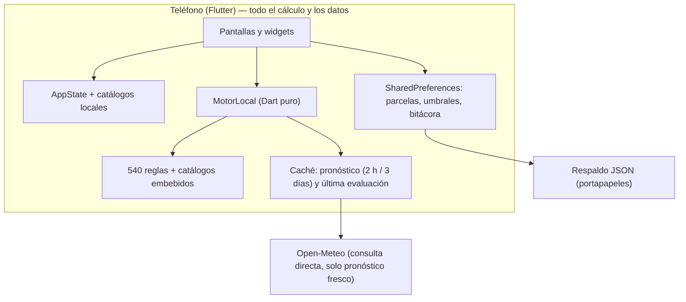

# Architecture

> La app móvil v2 es **100 % local**. El backend y el Admin Console se conservan
> en el repositorio como código histórico/de referencia. Ver
> [local-first.md](./local-first.md).

## Diagrama de capas (app móvil v2)



## Principio de diseño

La app no depende de ningún servicio propio. El motor de decisiones es una
función pura de clima + umbrales + reglas. La única llamada externa es
Open-Meteo para obtener un pronóstico fresco; si falla, se usa la caché local.
Los datos del productor nunca salen del teléfono.

## Estructura de carpetas

```text
CosechaClima/
|-- mobile/                        # App Flutter 100 % local (v2)
|   |-- lib/
|   |   |-- core/
|   |   |   |-- app/               # Onboarding
|   |   |   |-- cache/             # Pronóstico y última evaluación
|   |   |   |-- clima/             # Cliente Open-Meteo
|   |   |   |-- config/            # Constantes y centroides
|   |   |   |-- local/             # Migración de datos antiguos
|   |   |   |-- motor/             # Motor y paquete de reglas
|   |   |   |-- network/           # Excepciones de red
|   |   |   |-- services/          # GPS y notificaciones locales
|   |   |-- features/
|   |   |   |-- parcela/           # Parcelas locales (CRUD, detalle, edición)
|   |   |   |-- clima/             # Resumen semanal y servicio del motor
|   |   |   |-- catalogo/          # Catálogos desde el paquete embebido
|   |   |   |-- umbral/            # Umbrales locales
|   |   |   |-- bitacora/          # Bitácora local
|   |   |   |-- backup/            # Exportar/restaurar JSON
|   |   |   |-- onboarding/        # Splash, tutorial, acerca de, clima
|   |   |-- routing/
|   |   |-- shared/
|   |-- assets/reglas/paquete_reglas.json
|-- backend/                       # Backend histórico (opcional)
|-- adminconsole/                  # Admin Console histórica (opcional)
|-- docs/
|-- compose.yaml                   # Stack histórico (opcional)
```

## Stack tecnológico

| Capa | Tecnología | Justificación |
|---|---|---|
| App móvil | Flutter | Código único Android/iOS, sin animaciones |
| Motor | Dart puro | Corre en el teléfono, probable con `flutter test` |
| Reglas y catálogos | JSON embebido | 540 reglas disponibles desde el primer uso |
| Almacenamiento | `shared_preferences` | Simple, privado y suficiente para parcelas, bitácora y umbrales |
| Pronóstico | Open-Meteo | Sin API key; gratuito para uso no comercial; CC BY 4.0 |
| Notificaciones | `flutter_local_notifications` | Locales, sin FCM ni servidor |
| Respaldo | JSON + portapapeles | Portable sin permisos de archivos |
| Backend/Admin (legacy) | ASP.NET Core 10 + PostgreSQL 18 + React | Se conserva como referencia, no lo usa la app |

## Datos y persistencia

Las claves se documentan en [local-first.md](./local-first.md). En resumen:

- `parcelas_invitado`: parcelas locales (se conserva la clave histórica).
- `umbral_local`: umbrales del productor.
- `bitacora_local_v1`: entradas del cuaderno.
- `forecast_*`: series de Open-Meteo.
- `evaluacion_local_*`: última evaluación completa por parcela.
- `onboarding_visto`: tutorial.

La app migra una sola vez las parcelas del modo invitado anterior y la copia
`cache_lista_parcelas` que hubiera dejado el servidor. También migra los
umbrales antiguos.

## Motor de decisiones

Cruza 4 variables — evento climático activo, cultivo, etapa fenológica y tipo
de suelo — contra 540 combinaciones precargadas (6 eventos × 5 cultivos × 6
etapas × 3 suelos). Evalúa todos los eventos activos simultáneamente y retorna
la alerta con el nivel de riesgo más severo (Alto > Medio > Bajo). La ventana
de canícula usa también los días pasados que entrega Open-Meteo.

El contenido del árbol vive en
`mobile/assets/reglas/paquete_reglas.json`, no hardcodeado en Dart.

## Ver también

- [local-first.md](./local-first.md) — arquitectura y operación local.
- [mobile/README.es.md](../mobile/README.es.md) — instalar, compilar y respaldar.
- [postgresql.md](./postgresql.md) — base de datos del backend histórico.
- [api-reference.md](./api-reference.md) — API del backend histórico.
- [changelog.md](./changelog.md) — registro de cambios.
