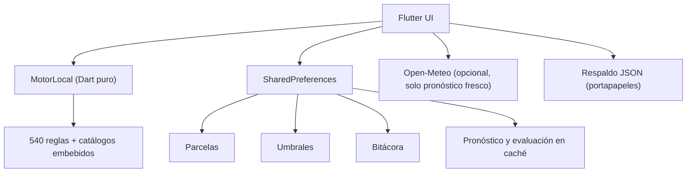

# App móvil 100 % local (Plan A)

> Estado: implementado en la versión móvil 2.0. El backend y el Admin Console
> siguen en el repositorio como código histórico/de referencia, pero la app
> móvil ya no los llama.

## Objetivo

Que CosechaClima siga funcionando siempre en el teléfono, sin depender de un
servidor encendido, de una cuenta, de una base de datos ni de un archivo
`.env`. El productor debe poder instalar la app, registrar su parcela y
consultar el semáforo aunque no tenga conexión en ese momento.

## Qué cambió respecto al Plan B

| Aspecto | Plan B (anterior) | Plan A (actual) |
|---|---|---|
| Arranque | `API_URL` obligatoria | La app arranca sin configuración |
| Cuentas | Google y correo/contraseña | No hay cuentas ni sesiones |
| Parcelas | Servidor + caché | Solo almacenamiento local |
| Umbrales | Servidor + cola de pendientes | Solo almacenamiento local |
| Bitácora | Servidor | Solo almacenamiento local |
| Reglas | Asset embebido + `GET /api/reglas/paquete` | Asset embebido, sin actualización remota |
| Respaldo | No existía | JSON exportable/importable desde el teléfono |
| Backend | Necesario | Opcional, código histórico |

## Arquitectura local



## Almacenamiento

| Clave | Contenido |
|---|---|
| `onboarding_visto` | Tutorial visto |
| `parcelas_invitado` | Parcelas locales (se conserva la clave histórica) |
| `umbral_local` | Umbrales del productor |
| `bitacora_local_v1` | Entradas de bitácora |
| `forecast_<lat>_<lon>` | Series de Open-Meteo |
| `evaluacion_local_<id>` | Último cálculo completo por parcela |

La app hace una migración de una sola vez:

1. conserva las parcelas del modo invitado anteriores;
2. convierte la copia `cache_lista_parcelas` del servidor en parcelas locales,
   usando los nombres de cultivo y suelo del paquete embebido;
3. migra los umbrales pendientes (`umbrales_pendientes`) o la copia
   (`umbrales_copia_motor`) a `umbral_local`.

Si una parcela antigua no tiene coordenadas ni un municipio reconocido, no se
puede migrar porque el motor necesita una ubicación. El resto de los datos no
se toca.

## Comportamiento sin conexión

- **Pronóstico:** Open-Meteo se consulta directo desde el teléfono. La copia
  local es fresca durante 2 horas y se puede usar hasta 3 días.
- **Semáforo y plan:** se calculan siempre en el teléfono con el pronóstico
  disponible y las reglas embebidas.
- **Último respaldo:** si el pronóstico venció y no hay red, se muestra la
  última evaluación completa guardada (`evaluacion_local_<id>`), con un aviso
  de que son datos guardados.
- **Bitácora, umbrales y parcelas:** no necesitan conexión en ningún momento.
- **Notificaciones:** son locales (`flutter_local_notifications`); no hay FCM.

## Copia de seguridad

`LocalBackupService` genera un JSON con:

```json
{
  "app": "CosechaClima",
  "formato": 1,
  "version": "2.0.0",
  "exportadoEn": "2026-10-22T...",
  "parcelas": [],
  "umbral": {},
  "bitacora": []
}
```

La pantalla `Copia de seguridad` permite copiarlo al portapapeles, verlo,
restaurarlo desde el portapapeles o pegarlo manualmente. Restaurar reemplaza
los datos actuales; la interfaz lo advierte antes de continuar.

## Dependencias externas

Solo queda **Open-Meteo** para pronósticos frescos:

- Licencia CC BY 4.0; la atribución se muestra en la app.
- El plan gratuito es para uso no comercial.
- Cada teléfono usa su propia cuota por IP.
- Sin conexión se usan la caché y la última evaluación local.

## Verificación

```bash
cd mobile
dart format --output=none --set-exit-if-changed lib test
flutter analyze --fatal-infos
flutter test
```

Las pruebas cubren:

- motor de 540 reglas y catálogos;
- caché de pronóstico;
- almacén de parcelas local;
- umbrales locales y migración de claves anteriores;
- bitácora local y resumen;
- exportación/importación de respaldo;
- centroides de municipios.
